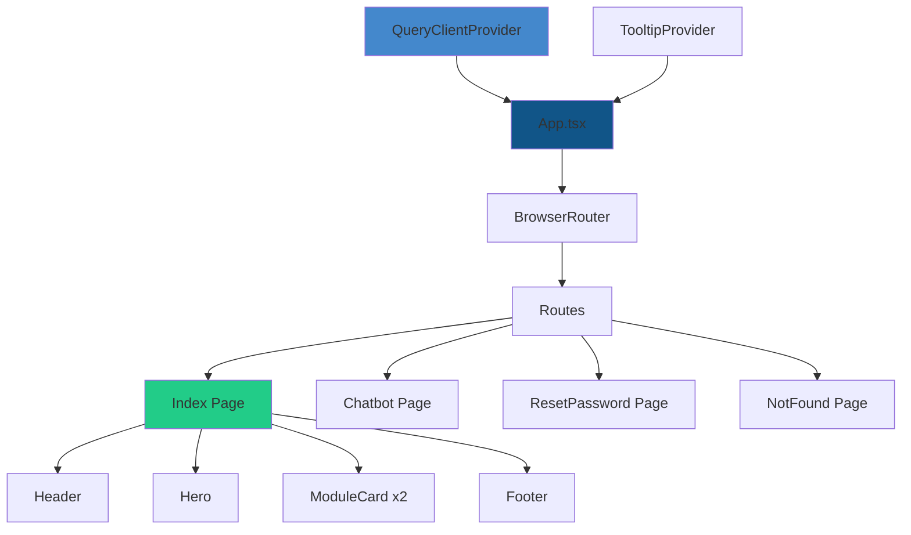

# Desarrollo Core - Landing Page Red Cultural Guaviare

## Información General

**Proyecto**: Red Cultural Guaviare - Plataforma Digital  
**Tipo**: Landing Page Institucional    
**Descripción**: Plataforma digital del Guaviare para turismo, cultura y gestión institucional. Descubre la belleza amazónica y accede a servicios gubernamentales.

---

## Stack Tecnológico

### Framework y Herramientas Core
- **Empaquetador**: [Vite](https://vitejs.dev/) v5.4.19
- **Framework**: [React](https://react.dev/) v18.3.1 con TypeScript v5.8.3
- **Routing**: [React Router DOM](https://reactrouter.com/) v6.30.1
- **Build Tool**: SWC para compilación ultra-rápida

### UI/UX y Estilos
- **Sistema de Diseño**: [shadcn/ui](https://ui.shadcn.com/) - Componentes accesibles y customizables
- **Estilos**: [Tailwind CSS](https://tailwindcss.com/) v3.4.17
- **Componentes Radix UI**: Suite completa de componentes primitivos (@radix-ui/*)
- **Iconos**: [Lucide React](https://lucide.dev/) v0.462.0
- **Animaciones**: tailwindcss-animate

### Gestión de Estado y Formularios
- **Estado Server**: [TanStack Query](https://tanstack.com/query) v5.83.0
- **Formularios**: [React Hook Form](https://react-hook-form.com/) v7.61.1
- **Validación**: [Zod](https://zod.dev/) v3.25.76

### Utilidades
- **Gestión de Clases**: clsx + tailwind-merge
- **Fechas**: date-fns v3.6.0
- **Notificaciones**: Sonner v1.7.4
- **Temas**: next-themes v0.3.0

---

## Arquitectura del Proyecto

```
guaviare-explore-hub/
├── src/
│   ├── assets/               # Recursos estáticos (imágenes)
│   ├── components/           # Componentes de UI
│   │   ├── ui/              # Componentes shadcn/ui (49 componentes)
│   │   ├── Header.tsx       # Navegación principal
│   │   ├── Hero.tsx         # Sección hero con imagen
│   │   ├── ModuleCard.tsx   # Tarjetas de módulos
│   │   └── Footer.tsx       # Pie de página
│   ├── hooks/               # Custom React hooks
│   ├── lib/                 # Utilidades y helpers
│   ├── pages/               # Páginas de la aplicación
│   │   ├── Index.tsx        # Página principal
│   │   ├── Chatbot.tsx      # Página de chatbot
│   │   ├── ResetPassword.tsx # Recuperación de contraseña
│   │   └── NotFound.tsx     # Página 404
│   ├── App.tsx              # Componente raíz
│   ├── main.tsx             # Entry point
│   └── index.css            # Estilos globales y sistema de diseño
├── public/                  # Archivos públicos
├── index.html               # HTML principal
├── tailwind.config.ts       # Configuración de Tailwind
├── vite.config.ts           # Configuración de Vite
└── package.json             # Dependencias del proyecto
```

---

## Sistema de Diseño

### Paleta de Colores (HSL)

#### Colores Principales
```css
/* Inspirados en la naturaleza del Guaviare */
--primary: 158 64% 22%           /* Verde Amazonas */
--primary-foreground: 120 20% 98% /* Texto sobre primary */
--primary-glow: 158 64% 45%      /* Efecto glow */

--secondary: 200 85% 45%         /* Azul Rio */
--secondary-foreground: 0 0% 100% /* Blanco */
```

#### Colores de Fondo
```css
--background: 120 20% 98%        /* Fondo general claro */
--foreground: 158 25% 15%        /* Texto principal */
--card: 0 0% 100%                /* Fondo de tarjetas */
```

#### Colores de Apoyo
```css
--muted: 45 25% 90%              /* Tonos tierra apagados */
--accent: 45 65% 65%             /* Tonos tierra acentuados */
--destructive: 0 84.2% 60.2%     /* Rojo para alertas */
```

### Gradientes Personalizados
```css
--gradient-hero: linear-gradient(135deg, 
  hsl(158 64% 22%), 
  hsl(158 64% 45%), 
  hsl(200 85% 45%))

--gradient-card: linear-gradient(145deg, 
  hsl(0 0% 100%), 
  hsl(120 15% 96%))

--gradient-nature: linear-gradient(180deg, 
  hsl(158 30% 95%), 
  hsl(158 20% 98%))
```

### Sombras con Tema Natural
```css
--shadow-nature: 0 10px 30px -5px hsl(158 64% 22% / 0.2)
--shadow-card: 0 4px 20px -2px hsl(158 25% 15% / 0.08)
--shadow-glow: 0 0 40px hsl(158 64% 45% / 0.3)
```

### Animaciones Personalizadas

#### Float (Flotante)
```typescript
'float': {
  '0%, 100%': { transform: 'translateY(0px)' },
  '50%': { transform: 'translateY(-10px)' }
}
// Duración: 3s ease-in-out infinite
```

#### Glow Pulse (Brillo Pulsante)
```typescript
'glow-pulse': {
  '0%, 100%': { opacity: '0.8' },
  '50%': { opacity: '1' }
}
// Duración: 2s ease-in-out infinite
```

### Transiciones
```css
--transition-smooth: all 0.3s cubic-bezier(0.4, 0, 0.2, 1)
--transition-bounce: all 0.5s cubic-bezier(0.68, -0.55, 0.265, 1.55)
```

---

## Componentes Core

### 1. [Header.tsx]

**Responsabilidad**: Navegación principal sticky con logo animado

**Características**:
- Logo clickable con animación `glow-pulse`
- Navegación inteligente (recarga si estás en `/`, navega si estás en otra ruta)
- Scroll suave a secciones
- Sticky header con backdrop blur
- Responsive (menú oculto en móviles)

**Props**: Ninguna

**Estado**: Utiliza `useLocation()` y `useNavigate()` de React Router

---

### 2. [Hero.tsx]

**Responsabilidad**: Sección hero full-screen con imagen de fondo

**Características**:
- Imagen de fondo con overlay gradient
- Título flotante con animación `float`
- Botón CTA con scroll suave
- Indicador de scroll con bounce
- Diseño responsivo

**Elementos Visuales**:
- Imagen: `guaviare-hero.jpg` (Selva del Guaviare)
- Overlay: Gradiente verde amazonas con opacidad variable
- Altura: `min-h-screen`

---

### 3. [ModuleCard.tsx]

**Responsabilidad**: Tarjeta reutilizable para mostrar módulos del sistema

**Props**:
```typescript
interface ModuleCardProps {
  title: string;              // Título del módulo
  description: string;        // Descripción del módulo
  features: string[];         // Lista de características
  icon: LucideIcon;          // Icono de Lucide
  buttonText: string;        // Texto del botón CTA
  comingSoon?: boolean;      // Badge "Próximamente"
  onClick?: () => void;      // Handler del botón
}
```

**Características**:
- Hover effect con elevación (`-translate-y-2`)
- Icono animado con cambio de color
- Lista de features con bullets personalizados
- Botón deshabilitado si `comingSoon=true`
- Sombra `shadow-card-soft` → `shadow-nature` en hover

---

### 4. [Footer.tsx]

**Responsabilidad**: Pie de página con información de contacto

**Secciones**:
1. **Logo y Descripción**: Branding y misión
2. **Contacto** (id="contacto"): Email, teléfono, dirección
3. **Legal**: Copyright y derechos

**Características**:
- Grid responsivo (3 columnas en desktop)
- Fondo `bg-primary`
- Iconos de Lucide (MapPin, Mail, Phone)

---

## Páginas Principales

### [Index.tsx] - Página Principal

**Estructura**:

1. **Header** - Navegación sticky
2. **Hero** - Presentación visual
3. **Sección de Módulos** (id="modulos")
   - Chatbot de Turismo (Funcional ✅)
   - Sistema de Informes (Requiere Supabase ⚠️)
4. **Features Overview** - "¿Por qué elegir Guaviare Digital?"
   - IA Avanzada
   - Gestión Colaborativa
   - Transparencia
5. **Footer** - Información de contacto

**Navegación**:
- `/chatbot` → Funcional
- Sistema de informes → Toast informativo (requiere autenticación)

---

### Otras Páginas

#### [Chatbot.tsx]
Interfaz de chatbot para turismo (4,241 bytes)

#### [ResetPassword.tsx]
Recuperación de contraseña (11,156 bytes)

#### [NotFound.tsx]
Página 404 personalizada (794 bytes)

---

## Funcionalidades Implementadas

### Completadas

1. **Landing Page Responsive**
   - Hero full-screen con imagen
   - Navegación sticky
   - Footer informativo

2. **Sistema de Diseño Cohesivo**
   - Paleta de colores inspirada en la naturaleza del Guaviare
   - 49 componentes shadcn/ui personalizados
   - Animaciones suaves y micro-interacciones

3. **Routing**
   - React Router con 4 rutas
   - Página 404 personalizada
   - Navegación programática

4. **Módulos Presentados**
   - Chatbot de Turismo (funcional)
   - Sistema de Informes (pendiente de integración)

5. **SEO Básico**
   - Meta tags (title, description)
   - Open Graph para redes sociales
   - Favicon personalizado

### Pendientes de Integración

- **Base de datos**: Supabase para sistema de informes
- **Autenticación**: Sistema de usuarios con roles
- **Backend**: APIs para chatbot y gestión de informes

---

## Scripts Disponibles

```json
{
  "dev": "vite",                           // Servidor de desarrollo
  "build": "vite build",                   // Build de producción
  "build:dev": "vite build --mode development", // Build de desarrollo
  "lint": "eslint .",                      // Linting
  "preview": "vite preview"                // Preview del build
}
```

### Comandos de Uso

```bash
# Instalar dependencias
npm install

# Iniciar servidor de desarrollo (http://localhost:5173)
npm run dev

# Crear build de producción
npm run build

# Preview del build
npm run preview

# Ejecutar linter
npm run lint
```

---

## Componentes shadcn/ui Disponibles

El proyecto incluye **49 componentes** de shadcn/ui completamente personalizados:

<details>
<summary>Ver lista completa de componentes UI</summary>

1. accordion
2. alert-dialog
3. alert
4. aspect-ratio
5. avatar
6. badge
7. breadcrumb
8. **button** ⭐
9. calendar
10. **card** ⭐
11. carousel
12. chart
13. checkbox
14. collapsible
15. command
16. context-menu
17. dialog
18. drawer
19. dropdown-menu
20. form
21. hover-card
22. input-otp
23. input
24. label
25. menubar
26. navigation-menu
27. pagination
28. popover
29. progress
30. radio-group
31. resizable
32. scroll-area
33. select
34. separator
35. sheet
36. sidebar
37. skeleton
38. slider
39. sonner
40. switch
41. table
42. tabs
43. textarea
44. toast
45. toaster
46. toggle-group
47. toggle
48. tooltip

⭐ = Usados extensivamente en la landing
</details>

---

## Responsive Design

### Breakpoints (Tailwind)
- **sm**: 640px
- **md**: 768px  
- **lg**: 1024px
- **xl**: 1280px
- **2xl**: 1400px (contenedor máximo)

### Estrategia Mobile-First
- Grid responsivo: `grid-cols-1 md:grid-cols-2 lg:grid-cols-3`
- Navegación oculta en móviles: `hidden md:flex`
- Tipografía fluida: `text-4xl md:text-5xl md:text-7xl`

---

## SEO y Metadatos

### HTML Head ([index.html])

```html
<title>Red Cultural Guaviare</title>
<meta name="description" content="Plataforma digital del Guaviare..." />

<!-- Open Graph -->
<meta property="og:title" content="Red Cultural Guaviare" />
<meta property="og:description" content="Plataforma digital..." />
<meta property="og:type" content="website" />
<meta property="og:image" content="/src/assets/Secretaria.ico" />

<!-- Favicon -->
<link rel="icon" href="/src/assets/Secretaria.ico" />
```

---

## Configuración y Variables de Entorno

### Vite Config ([vite.config.ts])
```typescript
import { defineConfig } from 'vite'
import react from '@vitejs/plugin-react-swc'
import path from 'path'

export default defineConfig({
  plugins: [react()],
  resolve: {
    alias: {
      '@': path.resolve(__dirname, './src'),
    },
  },
})
```

### TypeScript Config
- [tsconfig.json] - Configuración base
- [tsconfig.app.json] - Config para la app
- [tsconfig.node.json] - Config para Node

---

## Dependencias Clave

### Producción
```json
{
  "react": "^18.3.1",
  "react-dom": "^18.3.1",
  "react-router-dom": "^6.30.1",
  "@tanstack/react-query": "^5.83.0",
  "react-hook-form": "^7.61.1",
  "zod": "^3.25.76",
  "lucide-react": "^0.462.0",
  "tailwindcss": "^3.4.17",
  "class-variance-authority": "^0.7.1",
  "clsx": "^2.1.1",
  "tailwind-merge": "^2.6.0"
}
```

### Desarrollo
```json
{
  "vite": "^5.4.19",
  "@vitejs/plugin-react-swc": "^3.11.0",
  "typescript": "^5.8.3",
  "eslint": "^9.32.0",
  "autoprefixer": "^10.4.21",
  "postcss": "^8.5.6"
}
```

---

## Mejores Prácticas Implementadas

### 1. **Componentización**
- Componentes reutilizables y atómicos
- Props tipadas con TypeScript
- Separación de responsabilidades

### 2. **Performance**
- SWC para compilación ultra-rápida
- Lazy loading de rutas (potencial mejora)
- Optimización de imágenes

### 3. **Accesibilidad**
- Componentes Radix UI (accesibles por defecto)
- Atributos ARIA implícitos
- Navegación por teclado

### 4. **DX (Developer Experience)**
- TypeScript estricto
- ESLint configurado
- Aliases de path (`@/`)
- Hot Module Replacement (HMR)

### 5. **Código Limpio**
- Nombres descriptivos
- Comentarios estratégicos
- Organización lógica de archivos

---

## Flujo de Datos



---

## Destacados Técnicos

### 1. Sistema de Diseño Escalable
El archivo [index.css] define todas las variables CSS usando HSL, permitiendo temas consistentes y cambios globales fáciles.

### 2. Tailwind Personalizado
El [tailwind.config.ts] extiende Tailwind con:
- Gradientes personalizados
- Sombras temáticas
- Animaciones propias
- Colores del sistema de diseño

### 3. Reutilización de Componentes
`ModuleCard` es un ejemplo perfecto de componente altamente configurable:
- 7 props para personalización total
- Estilos consistentes
- Comportamiento dinámico

### 4. Integración shadcn/ui
49 componentes pre-configurados y listos para usar, con personalización completa vía [components.json].

---

## Estadísticas del Proyecto

| Métrica | Valor |
|---------|-------|
| Páginas | 4 |
| Componentes personalizados | 4 |
| Componentes shadcn/ui | 49 |
| Dependencias totales | ~164 paquetes |
| Tamaño package.json | 2,798 bytes |
| Lenguaje principal | TypeScript |
| Framework CSS | Tailwind CSS |
| Bundler | Vite |

---

## Próximos Pasos Recomendados

### Corto Plazo
1. Integrar Supabase para autenticación
2. Conectar sistema de informes con base de datos
3. Implementar API del chatbot

### Mediano Plazo
4. Optimizar para PWA (Progressive Web App)
5. Añadir más animaciones y micro-interacciones
6. Dashboard de administración

### Largo Plazo
7. Internacionalización (i18n)
8. Analytics y seguimiento
9. Auditoría de seguridad

---

## Información de Contacto

**Email**: contacto@guaviaredigital.gov.co  
**Teléfono**: +57 (8) 584-7000  
**Ubicación**: San José del Guaviare, Guaviare, Colombia

---

## Licencia

© 2025 Gobernación del Guaviare - Todos los derechos reservados

---

## Enlaces Útiles

- [Documentación Vite](https://vitejs.dev/)
- [Documentación React](https://react.dev/)
- [shadcn/ui](https://ui.shadcn.com/)
- [Tailwind CSS](https://tailwindcss.com/)

---

**Documento generado**: Diciembre 2025  
**Versión del proyecto**: 0.0.0  
**Última actualización**: 2025-12-17
